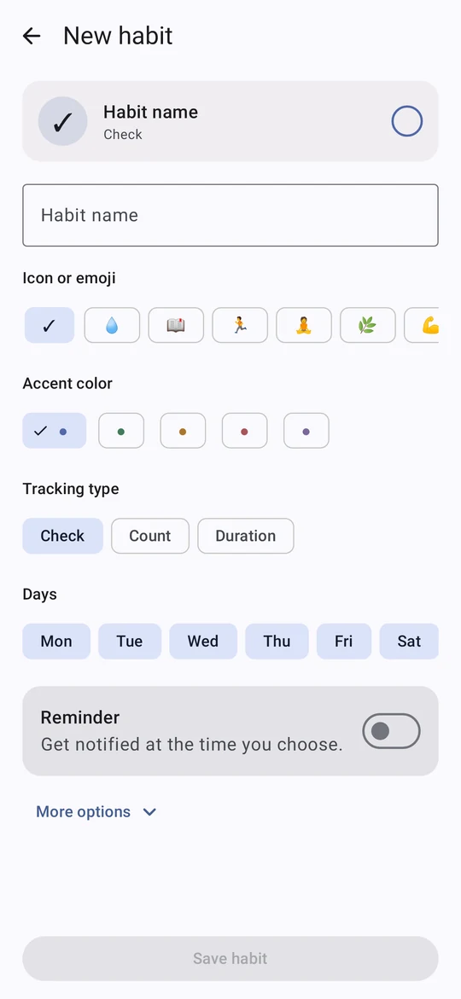
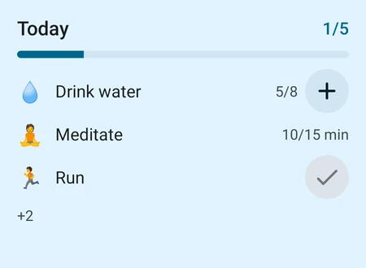
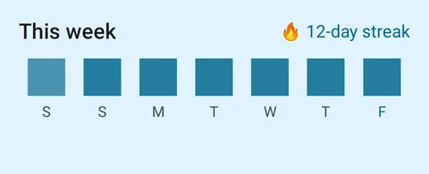

# Tsuzuku

**A simple, focused habit tracker for Android.** *Tsuzuku* (続く) means "to continue".

Check off today's habits in one tap, keep your streak going, and see the year fill up.
Built with Jetpack Compose and Material You, works fully offline, in English and Turkish.

<p>
  
  
  
</p>

## Features

- **Material 3 Expressive** — springy motion, wavy progress and a check button that morphs when you finish a habit.
- **Today** — one list, one tap per habit. Check, count (+1) and timed habits, grouped by routine.
- **Streaks that forgive** — one forgotten day a week doesn't break your streak; skipped days never count against you.
- **Progress** — statistics, a calendar, and a 12-month heatmap for every habit.
- **Coaching** — suggests a smaller target when one is rarely reached, then steps it back up; a one-tap evening mood with habit–mood insights.
- **Share** — turn any habit into an image card with its streak and the last 20 weeks.
- **Wear OS** — a Today tile and a small watch app; tapping a habit marks it on the phone.
- **Widgets** — Today list, single-habit ring and a weekly grid, all tappable from the home screen.
- **Reminders** — per-habit reminders with a "Done" action, plus an optional Sunday-evening weekly recap.
- **Quick access** — Quick Settings tile showing habits left today, and launcher shortcuts.
- **Your data** — local Room database, CSV/JSON backup, optional Google sign-in with Firestore sync, and in-app account deletion.
- **Privacy** — app lock with PIN or biometrics, optional screenshot protection.

<p>
  
  
</p>

## Build

Requirements: JDK 17 and the Android SDK (compile SDK 36). Min SDK is 26.

```bash
./gradlew assembleDebug          # APK in app/build/outputs/apk/debug/
./gradlew testDebugUnitTest      # unit tests
```

Cloud sync is optional. Without `app/google-services.json` the app builds and runs fully offline;
to enable Google sign-in and sync, follow [FIREBASE_SETUP.md](FIREBASE_SETUP.md).

### Screenshot previews

Every screen and widget can be rendered on the JVM (Robolectric, no emulator) in English/Turkish
and light/dark:

```bash
./gradlew testDebugUnitTest -Ppreviews --tests "*PreviewGalleryTest*"
python previews/build_gallery.py   # writes previews/site/ (open index.html)
```

## Project layout

| Path | What's there |
| --- | --- |
| `app/src/main/java/app/tsuzuku/ui` | Compose screens, navigation, theme |
| `app/src/main/java/app/tsuzuku/model` | Domain models, streak and history logic |
| `app/src/main/java/app/tsuzuku/data` | Room database, repositories, backup and cloud sync |
| `app/src/main/java/app/tsuzuku/widget` | Glance home-screen widgets |
| `app/src/main/java/app/tsuzuku/notifications` | Reminders and the weekly recap |
| `app/src/main/java/app/tsuzuku/wear` | Phone side of the watch sync (Data Layer) |
| `wear/` | Wear OS app and tile |
| `previews/` | JVM screenshot gallery |

See [CHANGELOG.md](CHANGELOG.md) for release notes (in Turkish).

## License

[MIT](LICENSE)
