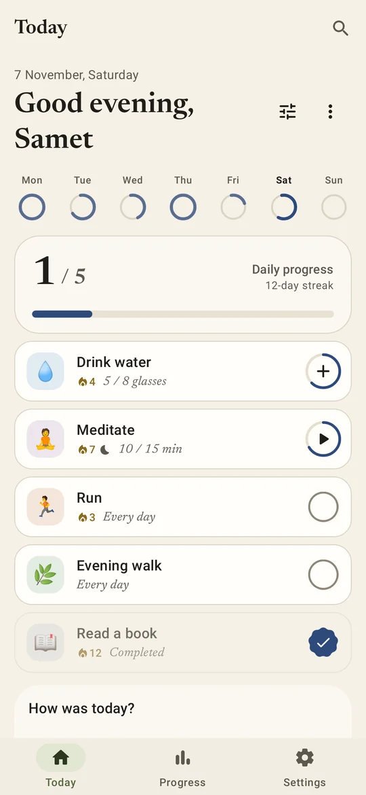
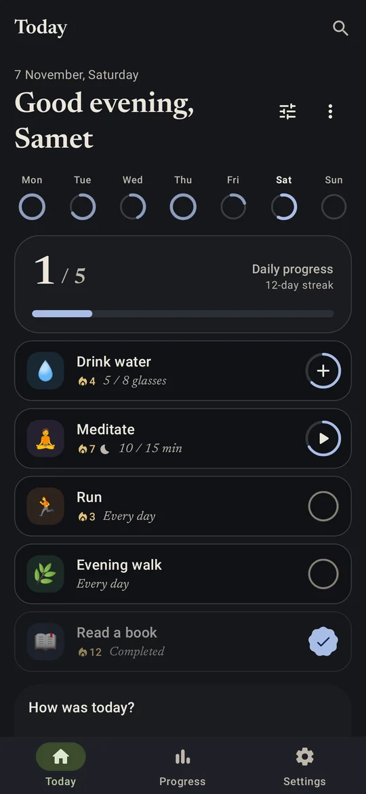
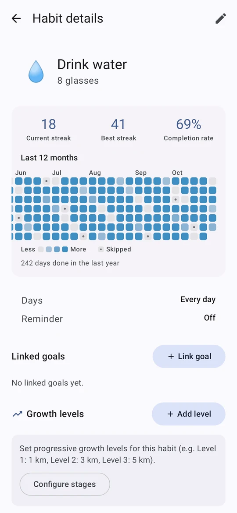
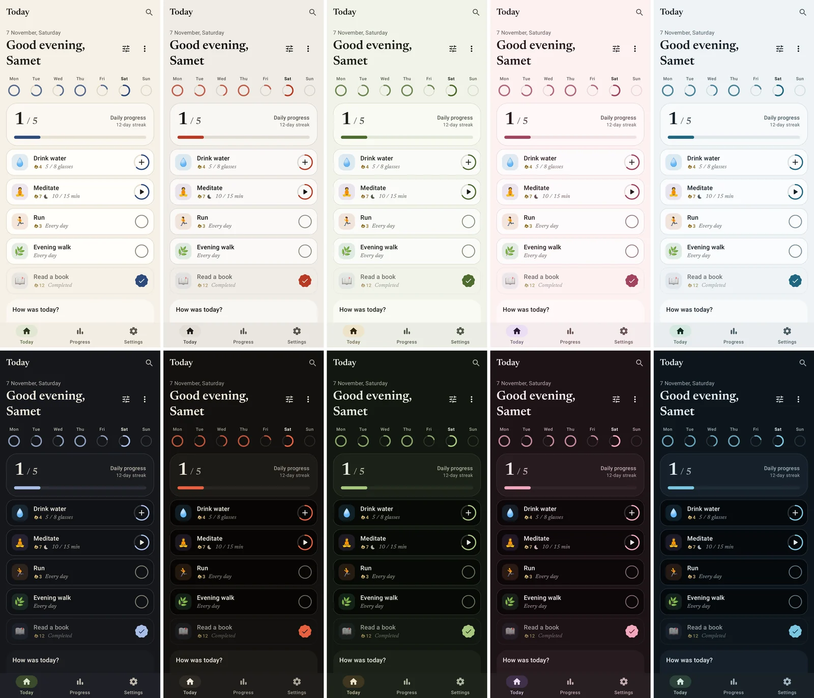
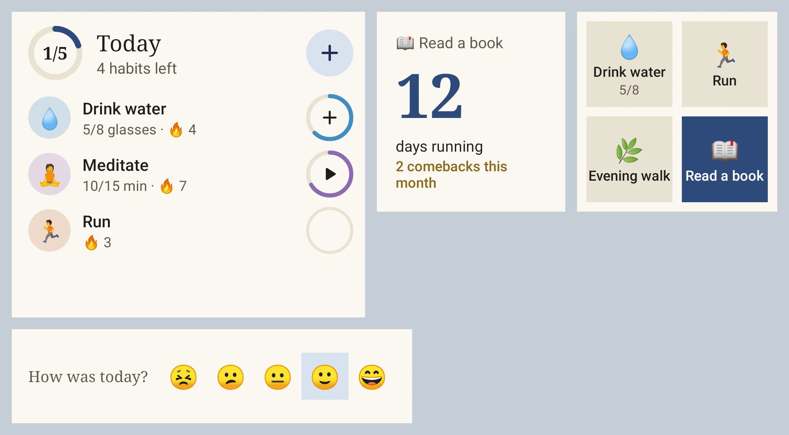

# Kinmichi

**A calm habit tracker for Android that helps you keep going.** *Kinmichi* (金道) is Japanese for
"the golden path": the road you walk a little every day, with the breaks mended in gold.
(Formerly called Tsuzuku.)

Most habit apps punish you when a streak breaks. Kinmichi is built around the moment after:
a smaller version of the habit for bad days, a nudge never to miss twice, and comebacks that are
mended in gold instead of hidden. Free, open source, no ads, no tracking, works offline.

[Türkçe](README.tr.md)

<p>
  
  
  
</p>

## Install

Kinmichi is distributed here on GitHub, not on the Play Store.

- **With [Obtainium](https://github.com/ImranR98/Obtainium) (recommended):** add
  `https://github.com/sametackgz41/tsuzuku` as an app. Set the APK filter to `^tsuzuku-[0-9]`
  so it picks the phone app, not the watch app. Obtainium then installs every update for you.
- **By hand:** download `tsuzuku-x.y.z.apk` from the [latest release](https://github.com/sametackgz41/tsuzuku/releases/latest)
  and open it. Android will ask you to allow installs from your browser or file manager once.
- **Wear OS (optional):** `tsuzuku-wear-x.y.z.apk` from the same release, installed on the watch.

Updates install over the previous version; your data stays.

## What it does

**Keep going**
- **Bad-day version** — write the smallest step that still counts ("1 page"). Doing it keeps the streak.
- **Never miss twice** — after a missed day, Today offers that small version in one tap.
- **If–then plans** — "If I finish dinner, I read 10 pages", shown on Today and in the reminder.
- **Kintsugi** — the day you come back after a break is counted and drawn in gold on the heatmap.
- **Streaks that forgive** — one rest day a week; skipped days never count against you.

**Less effort**
- **Health Connect** — link a habit to steps, distance, calories, exercise or sleep and it fills itself.
- **Smart reminders** — if you usually do a habit at 07:40 but the reminder rings at 21:00, Kinmichi suggests moving it.
- **Streak alert** — one evening note, only when a streak of 3+ days is about to break.
- **Coaching** — suggests a smaller target when one is rarely reached, then steps it back up.

**Look and feel**
- **Five palettes** — Washi, Sumi, Matcha, Sakura and Umi, each with a light and a dark side, or your wallpaper colours. Optional pure black at night.
- **Editorial type** — Newsreader serif for headings and numbers.
- **Material 3 Expressive** motion: springy transitions and a check button that morphs when you finish.

<p>
  
</p>

**Everywhere**
- **Widgets** — Today list, single habit, this week, streak, quick grid (four habits, one tap each) and mood. Adjustable opacity.
- **Wear OS** — a Today tile and a small watch app; a tap marks the habit on the phone.
- **Quick access** — Quick Settings tile and launcher shortcuts.
- **Share** — turn a habit into an image card with its streak and the last 20 weeks.

<p>
  
</p>

**Your data**
- Everything lives on the phone (Room database). CSV/JSON backup and restore.
- Optional Google sign-in with cloud sync, and in-app account deletion.
- App lock with PIN or biometrics, optional screenshot protection.
- See [PRIVACY.md](PRIVACY.md) for exactly what is stored where.

English and Turkish. [Translations are welcome](CONTRIBUTING.md#translating).

## Feedback

Found a bug or have an idea? [Open an issue](https://github.com/sametackgz41/tsuzuku/issues/new/choose).
The app can also do it for you: **Settings › Error reports › Report on GitHub** fills in the
version and the last error log.

## Build

Requirements: JDK 17 and the Android SDK (compile SDK 36). Min SDK is 26.

```bash
./gradlew assembleDebug          # APK in app/build/outputs/apk/debug/
./gradlew testDebugUnitTest      # unit tests
```

Cloud sync is optional. Without `app/google-services.json` the app builds and runs fully offline;
to enable Google sign-in and sync, follow [FIREBASE_SETUP.md](FIREBASE_SETUP.md).

### Screenshot previews

Every screen and widget can be rendered on the JVM (Robolectric, no emulator) in English/Turkish
and light/dark:

```bash
./gradlew testDebugUnitTest -Ppreviews --tests "*PreviewGalleryTest*"
python previews/build_gallery.py   # writes previews/site/ (open index.html)
```

## Project layout

| Path | What's there |
| --- | --- |
| `app/src/main/java/app/tsuzuku/ui` | Compose screens, navigation, theme and palettes |
| `app/src/main/java/app/tsuzuku/model` | Domain models: streaks, history, comebacks, smart reminders |
| `app/src/main/java/app/tsuzuku/data` | Room database, repositories, backup and cloud sync |
| `app/src/main/java/app/tsuzuku/health` | Health Connect reader |
| `app/src/main/java/app/tsuzuku/widget` | Glance home-screen widgets |
| `app/src/main/java/app/tsuzuku/notifications` | Reminders, streak alert, mood check-in, weekly recap |
| `app/src/main/java/app/tsuzuku/wear` | Phone side of the watch sync (Data Layer) |
| `wear/` | Wear OS app and tile |
| `previews/` | JVM screenshot gallery |

Release notes: [CHANGELOG.md](CHANGELOG.md) (in Turkish) and each [release](https://github.com/sametackgz41/tsuzuku/releases).

## License

[MIT](LICENSE). The Newsreader font is under the [SIL Open Font License](licenses/Newsreader-OFL.txt).
