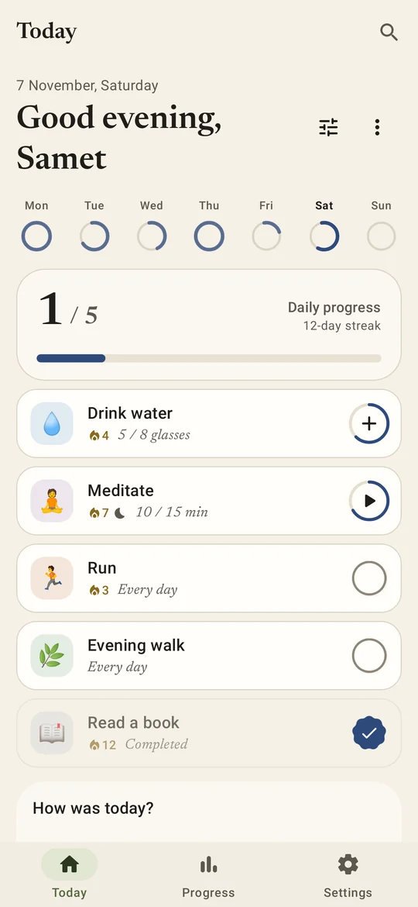
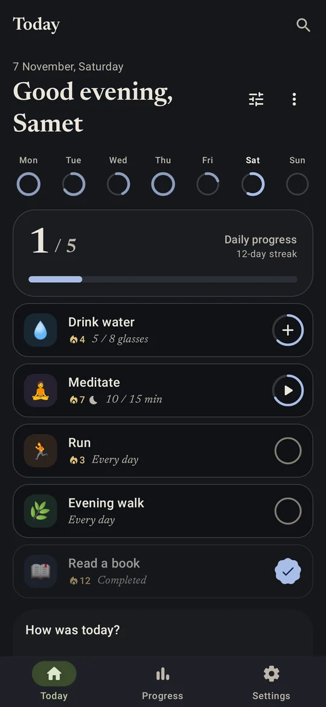
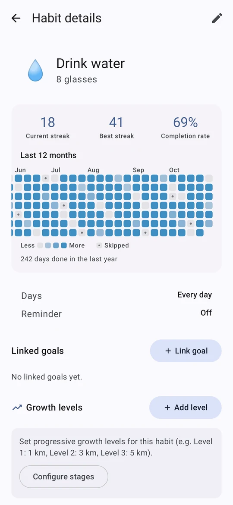
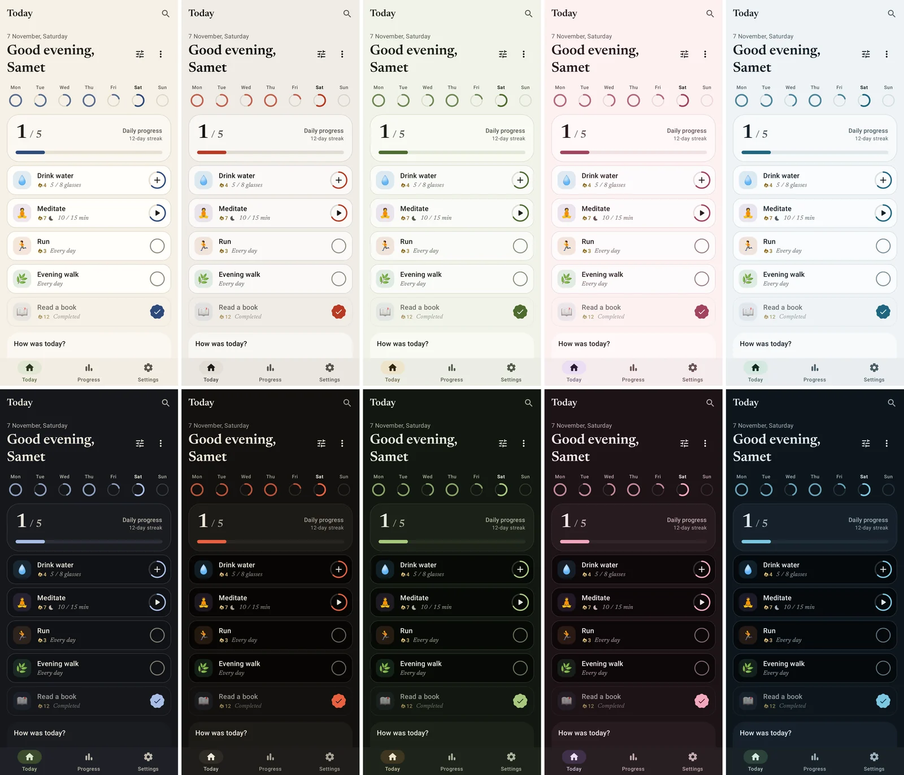
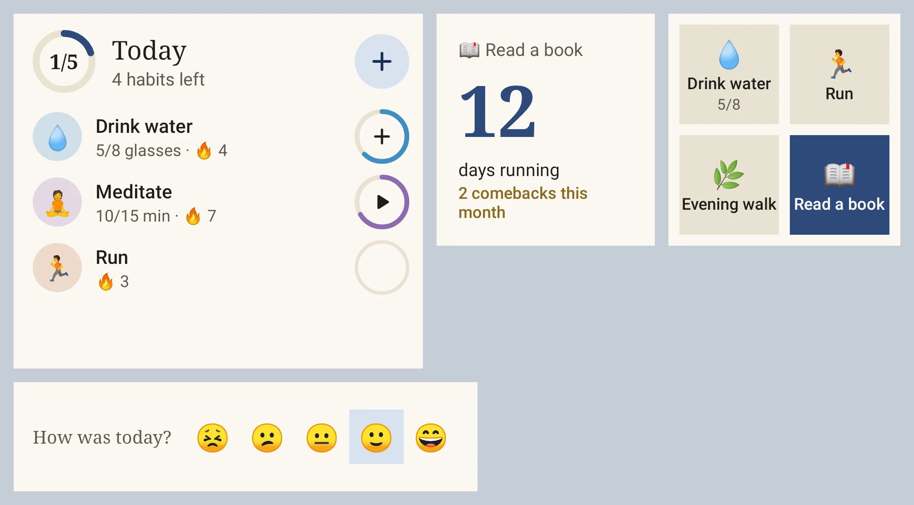

# Kinmichi

**Devam etmene yardım eden sakin bir alışkanlık uygulaması.** *Kinmichi* (金道) Japonca "altın yol"
demek: her gün biraz yürüdüğün, kopan yerleri altınla onarılmış yol. (Eski adı Tsuzuku.)

Çoğu alışkanlık uygulaması seri koptuğunda seni cezalandırır. Kinmichi ise o andan sonrasına
odaklanır: kötü günler için alışkanlığın küçük bir sürümü, iki kez kaçırmamak için bir dürtme ve
saklanmak yerine altınla onarılan geri dönüşler. Ücretsiz, açık kaynak, reklamsız, takipsiz,
internetsiz çalışır.

[Web sitesi](https://sametackgz41.github.io/kinmichi/) · [English](README.md)

  
  
  

## Kurulum

Kinmichi Play Store'da değil, burada GitHub'da yayınlanıyor.

- **[Obtainium](https://github.com/ImranR98/Obtainium) ile (önerilen):** uygulama olarak
  `https://github.com/sametackgz41/kinmichi` adresini ekle. Saat uygulaması yerine telefon
  uygulamasını seçmesi için APK filtresine `^(kinmichi|tsuzuku)-[0-9]` yaz. Sonraki her güncellemeyi Obtainium kurar.
- **Elle:** [son sürümden](https://github.com/sametackgz41/kinmichi/releases/latest) `kinmichi-x.y.z.apk`
  dosyasını indirip aç. Android bir kereliğine tarayıcıdan ya da dosya yöneticisinden kurulum izni ister.
- **Wear OS (isteğe bağlı):** aynı sürümdeki `kinmichi-wear-x.y.z.apk`, saate kurulur.

Güncellemeler eski sürümün üstüne kurulur, verilerin yerinde kalır.

## Neler yapıyor

**Devam etmek**
- **Kötü gün sürümü:** yine de sayılan en küçük adımı yaz ("1 sayfa"). Onu yapmak seriyi korur.
- **İki kez kaçırma:** kaçırılan bir günden sonra Bugün ekranı o küçük sürümü tek dokunuşla önerir.
- **Eğer-o zaman planı:** "Eğer yemeği bitirirsem, 10 sayfa okurum"; Bugün ekranında ve hatırlatmada görünür.
- **Kintsugi:** aradan sonra geri döndüğün gün sayılır ve ısı haritasında altınla çizilir.
- **Affeden seriler:** haftada bir dinlenme günü; atlanan günler aleyhine sayılmaz.

**Daha az uğraş**
- **Health Connect:** bir alışkanlığı adım, mesafe, kalori, egzersiz ya da uykuya bağla, kendiliğinden dolsun.
- **Akıllı hatırlatma:** genelde 07:40'ta yaptığın bir alışkanlığın hatırlatması 21:00'deyse, taşımayı önerir.
- **Seri uyarısı:** akşam tek bir not, sadece 3+ günlük bir seri bozulmak üzereyse.
- **Koçluk:** nadiren tutturulan bir hedef için daha küçüğünü önerir, sonra adım adım geri büyütür.

**Görünüm**
- **Beş palet:** Washi, Sumi, Matcha, Sakura ve Umi; her birinin açık ve koyu tarafı var, ya da duvar kâğıdı renkleri. Gece için isteğe bağlı saf siyah.
- **Serif başlıklar:** başlıklar ve rakamlar Newsreader yazı tipiyle.
- **Material 3 Expressive** hareketler.

  

**Her yerde**
- **Widget'lar:** Bugün listesi, tek alışkanlık, bu hafta, seri, hızlı ızgara ve ruh hali. Opaklık ayarlanabilir.
- **Wear OS:** Bugün kutucuğu ve küçük bir saat uygulaması.
- **Hızlı erişim:** Hızlı Ayarlar kutucuğu ve başlatıcı kısayolları.
- **Paylaş:** bir alışkanlığı serisi ve son 20 haftasıyla görsel karta dönüştür.

  

**Verilerin**
- Her şey telefonda durur. CSV/JSON yedekleme ve geri yükleme.
- İsteğe bağlı Google girişi ile bulut eşitleme; hesap uygulama içinden silinebilir.
- PIN ya da biyometrik uygulama kilidi, isteğe bağlı ekran görüntüsü koruması.
- Neyin nerede durduğu: [PRIVACY.md](PRIVACY.md).

Türkçe ve İngilizce. [Çeviri katkısı memnuniyetle](CONTRIBUTING.md#translating).

## Geri bildirim

Bir hata mı buldun ya da bir fikrin mi var? [Bir sorun kaydı aç](https://github.com/sametackgz41/kinmichi/issues/new/choose).
Uygulama da bunu senin için yapabilir: **Ayarlar › Hata raporları › GitHub'da bildir**, sürümü ve
son hata kaydını otomatik doldurur.

Derleme ve proje yapısı için: [README.md](README.md#build).

## Lisans

[MIT](LICENSE). Newsreader yazı tipi [SIL Open Font License](licenses/Newsreader-OFL.txt) altında.
